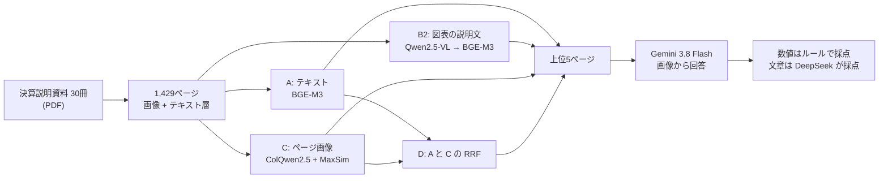

# multimodal-rag（日本語版）

[English](README.md)

決算説明資料のグラフや表について質問されたとき、どの検索方式が一番よく答えにたどり着けるかを比べた実験です。1,429ページのスライドに対して、自作し、別の AI が確認した80問の評価セットを使いました。4つの方式それぞれについて、検索の精度、回答の正解率、差の不確かさ（95% の範囲）を測っています。

**分かったこと**

- **ページの文字ではなく、ページの画像で検索するほうが強い。** ColQwen2.5（方式 C）は、根拠のページを上位5件に入れられた問題が85%で、文字の埋め込み（方式 A）の66%を上回りました。回答の正解率も 0.625 から 0.775 に上がりました（+0.150、95% の範囲 [+0.037, +0.263]）。
- **ローカルの VLM で図表ごとに説明文を作る方式（B2）は効きませんでした。** インデックスを作るのに GPU で5.2時間かかったうえ、約9%のページでモデルが同じ出力を繰り返し、使える説明文が得られませんでした。
- **文字と画像の順位を組み合わせる方式（D）は、画像だけ（C）より悪くなりました**（MRR −0.076 [−0.151, −0.005]）。文字の検索の弱さが、C が1位に当てていたページの順位を引き下げたためです。実行の前に立てた予想とは違う結果でした。
- **回答の正しさを決めるのは、読み取りではなく検索です。** 上位5件に根拠のページが入っていれば、どの方式でも Gemini は91〜96%の問題に正しく答えます。正解ページを直接渡した場合の正解率は 0.925 でした。

データは、5業界15社の決算説明資料です。各社2冊（2026年3月期の通期と、翌期の第1四半期）を使いました。出典は [docs/sources.csv](docs/sources.csv) にあります。PDF そのものは再配布していません。

## 方式

| | 何を検索対象にするか | モデル | ページの点数 |
|---|---|---|---|
| **A** | ページのテキスト層（PyMuPDF） | `BAAI/bge-m3`（1ページ1ベクトル） | コサイン類似度 |
| **B2** | ページ画像を VLM に読ませて作った、図表ごとの説明文 | 説明文は `qwen2.5vl:7b`（Ollama）、埋め込みは `BAAI/bge-m3` | ページ内で一番近い図表の点数。図表のないページは返さない |
| **C** | ページの画像 | `vidore/colqwen2.5-v0.2`（複数ベクトル） | Late Interaction（MaxSim） |
| **D** | – | A と C の順位 | Reciprocal Rank Fusion（k = 60） |

B1（B を Claude API で行う方式）は、開発者の判断で行っていません。どの方式も、すべての質問で1,429ページ全体に順位を付けます。設定は、各方式を初めて実行する前に [configs/](configs) で固定しました。

## 評価セット

[eval/questions.csv](eval/questions.csv) の80問です。根拠の種類は、グラフ32問、表24問、図12問、本文12問です。形式と採点のルールは [eval/README.md](eval/README.md) にあります。

- 8問は開発者が作りました。残りの72問は Claude が作り、問題づくりの文脈を持たない別の AI がページ画像と照らし合わせて確認したうえで採用しました。
- 後半の40問は、検索の結果を見ずに、シードを固定して無作為に選んだページから作りました。特定の方式が得意なページに偏らないようにするためです。
- 問題を作ったのが Claude なので、回答の生成と採点には Claude を使っていません。

## 検索の結果

上位 k 件に、正解ページのすべてのグループがそろったとき、その問題は「答えられる」とみなします。MRR は、それが初めてそろった順位で計算します。

| 方式 | Recall@1 | Recall@3 | Recall@5 | MRR |
|---|---|---|---|---|
| A：テキスト | 0.388 | 0.575 | 0.662 | 0.519 |
| B2：図表の説明文 | 0.388 | 0.537 | 0.600 | 0.484 |
| C：ページ画像 | **0.625** | **0.825** | **0.850** | **0.737** |
| D：A + C（RRF） | 0.537 | 0.762 | 0.838 | 0.661 |

差は質問ごとに対応をとって計算し、95% の範囲はブートストラップ（10,000回、シード0）で求めました。

| | MRR の差 [95%] | Recall@5 の差 [95%] |
|---|---|---|
| B2 − A | −0.035 [−0.133, +0.065] | −0.062 [−0.163, +0.037] |
| C − A | **+0.219 [+0.124, +0.316]** | **+0.188 [+0.087, +0.287]** |
| D − A | +0.142 [+0.082, +0.206] | +0.175 [+0.087, +0.263] |
| D − C | **−0.076 [−0.151, −0.005]** | −0.013 [−0.087, +0.062] |

グラフは英語版の README と [results/figures/](results/figures) にあります。

DeepSeek による文章の質問の採点は、開発者が110件すべてを目で確認し、すべて一致しました（22問 × 5条件。正しい90件、誤り20件）。根拠の種類別・作成者別の表は [results/comparison.md](results/comparison.md) にあります。

## 回答の結果

`google/gemini-3.8-flash` が、各方式の上位5ページを見て答えます。上限を測るために、正解ページを直接渡した条件も加えました。モデルに渡すのは、質問と「ページ1〜5」とラベルを付けた画像だけです。ページ ID は渡しません。ID には会社名と資料名が入っていて、それ自体が答えの手がかりになってしまうからです。

採点のしかたは、問題の種類で分けています。
- **数値の質問（58問）**：ルールで採点します。数値が資料に表示された値と一致し、単位も同じなら正解です。同じ単位の別の書き方（ポイントと pt など）は同じとみなしますが、桁の違う単位は同じとみなしません。
- **文章の質問（22問）**：`deepseek/deepseek-v4.1-flash-1017` が、正解の文と照らし合わせて採点します。

| 条件 | 正解率 | A との差 [95%] | 上位5件に根拠がそろったとき | そろわなかったとき |
|---|---|---|---|---|
| A | 0.625 | | 0.906（n=53） | 0.074（n=27） |
| B2 | 0.613 | −0.013 [−0.113, +0.087] | 0.958（n=48） | 0.094（n=32） |
| C | 0.775 | **+0.150 [+0.037, +0.263]** | 0.912（n=68） | 0.000（n=12） |
| D | 0.787 | +0.163 [+0.062, +0.263] | 0.940（n=67） | 0.000（n=13） |
| 正解ページ（上限） | 0.925 | +0.300 [+0.188, +0.412] | 0.925（n=80） | – |

40問の時点では、C の回答での優位は「差があるとは言えない」範囲でした（+0.125 [−0.025, +0.275]）。80問に増やしたことで、差があると言えるようになりました。

## どこで失敗するか

[`scripts/analyze_failures.py`](scripts/analyze_failures.py) で、検索の失敗（上位5件に根拠がそろわなかった問題）を、1位のページの種類で分類しました。

| 方式 | 1位が聞かれた会社のページ | 失敗 | 別の会社 | 同じ会社の別の資料 | 同じ資料の別ページ | 説明文なし |
|---|---|---|---|---|---|---|
| A | 66/80 | 27 | 10 | 4 | 13 | 0 |
| B2 | 65/80 | 32 | 6 | 5 | 14 | 7 |
| C | **76/80** | **12** | 2 | 5 | 5 | 0 |
| D | 72/80 | 13 | 3 | 2 | 8 | 0 |

- **テキストの検索は、会社を取り違えます。** A の失敗27問のうち10問で、1位のページが別の会社のものでした。決算資料は会社が違っても「売上収益」「営業利益」「前年同期比」といった同じ言葉を使い、会社名はロゴにしか書かれていないことがよくあります。ロゴやレイアウトを見ている C は、この間違いをほとんどしません。
- **C の失敗は、同じ会社の中での取り違えです。** 通期と第1四半期の資料の取り違えや、パイプラインの表・セグメント別の内訳のように、よく似たページどうしの取り違えです。
- **D が C に負けた理由。** D を実行する前に、「C が苦手な文字の多いページは A が補い、D の MRR は C と同じくらいになる」と予想しました。前半は当たりました。40問の時点で、C が外した3問が D では上位5件に入りました。一方、後半は外れました。k = 60 の RRF では、C で1位・A で151位のページよりも、両方で5〜8位くらいのページのほうが高い点数になります。そのため、A が会社を取り違えたことで、C が正しく当てていたページが押し下げられました。結果を見たあとで重みや k を調整することはしていません。調整すれば、この評価セットに合わせ込むことになるからです。

## インデックスを作る手間

B2 は、埋め込みの前に、ページごとに1回ずつ説明文を生成する必要があります。RX 9070 XT で `qwen2.5vl:7b` を使い、1,429ページの説明文を作るのに **5.2時間（1ページ約13秒）** かかりました。時間のほとんどは、出力を1トークンずつ生成する部分です（1ページの出力は中央値で約400トークン）。できた2,130件の説明文を埋め込むのは約9秒で終わりました。A と C は、各ページをモデルに1回通すだけで済みます。D は A と C のインデックスをそのまま使います。

## 弱点

- **B2 の説明文のループ。** 1,429ページのうち125ページ（8.7%）で、使える説明文が得られませんでした。正解ページ127ページのうち10ページが該当し、そのせいで B2 がどうしても当てられない問題が7問あります。
- **B2 の幻覚。** 見出しだけの区切りのページで、モデルが存在しないグラフを作り出すことがあります。
- **C は英語で学習されたモデルです。** 質問は日本語なので、この条件に合わせた調整はしていません。
- **回答を同じ形で作り直せません。** Gemini 3.x は temperature を無視し、`gemini-3.8-flash` には日付つきの固定版がありません。再現性は、保存した返事と、返事ごとに記録した提供元・モデル名で担保しています。
- **ルールで採点すると、正しい回答の一部を不正解にしてしまいます。** 減った額の符号の書き方の違いなどで、内容は正しいのに不正解になった回答が12件あります。どの方式にも同じくらい起きているので、方式どうしの比較への影響は小さいですが、正解率はやや低めに出ています。
- **評価セットの多くは AI が作っています。** 80問のうち72問は Claude が作り、別の AI が確認したもので、人は確認していません。開発者が作った8問でも C が1位でしたが、8問ではそれ以上のことは言えません。

## 再現のしかた

コマンドは [英語版の Reproducing](README.md#reproducing) にあります。結果は `results/<種類>/<日時>/` に保存されます。`run.json` には、設定、モデルの版、評価セットとページ一覧のハッシュ、git のコミット（未コミットの変更がなかったか）、パッケージの版が入っています。環境構築の手順と、Windows + ROCm でつまずいた点は、英語版の Setup と Setup notes にまとめています。
