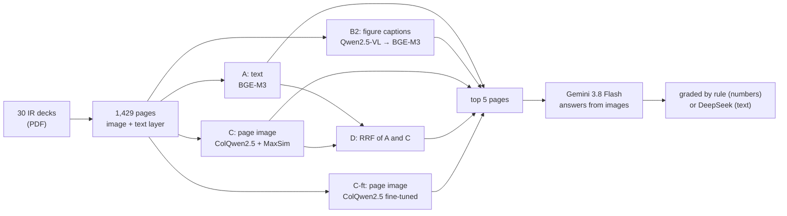
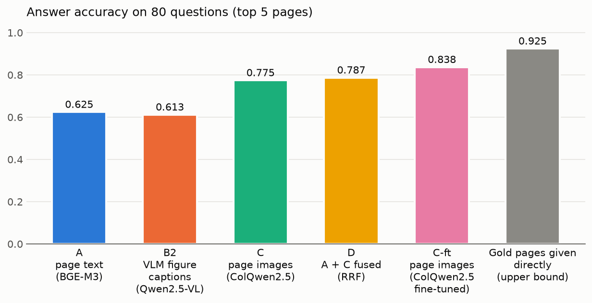

# multimodal-rag

[日本語版](README.ja.md)

Which retrieval method works best for questions about the charts and tables in Japanese earnings presentations? This repository compares five methods on a self-built, reviewed set of 80 questions over 1,429 slide pages. It reports retrieval quality, answer accuracy and uncertainty intervals for each.

**Findings**

- **Searching page images beats searching page text.** ColQwen2.5 (C) finds a page with the evidence in the top 5 for 85% of questions, against 66% for text embeddings (A). Answer accuracy rises from 0.625 to 0.775 (+0.150, 95% interval [+0.037, +0.263]).
- **Asking a local VLM to caption every figure first (B2) did not help**, and it cost 5.2 GPU hours to index. About 9% of pages got no usable caption because the model looped.
- **Fusing text and image rankings (D) was worse than images alone** on MRR (−0.076 [−0.151, −0.005]). The weaker text ranking pulled down pages that C had ranked first. This was not what I predicted before running it.
- **Fine-tuning the image retriever on other companies' decks helped further.** ColQwen2.5 trained for 48 minutes on 1,091 synthetic questions about 8 companies that are not in the evaluation set (C-ft) raised Recall@1 from 0.625 to 0.688 and answer accuracy from 0.775 to 0.838 (+0.062 [+0.013, +0.125] over C). One training run, one seed.
- **Retrieval, not reading, limits the answers.** When the top 5 pages contain the evidence, Gemini answers about 91–96% correctly with any method. With the gold pages given directly it reaches 0.925.



Data: 15 companies across 5 industries, 2 decks each (full year to March 2026 and Q1 of the following year). Sources are listed in [docs/sources.csv](docs/sources.csv); the PDFs themselves are not redistributed.

## Methods

| | What is indexed | Model | Page score |
|---|---|---|---|
| **A** | the page's text layer (PyMuPDF) | `BAAI/bge-m3`, one vector per page | cosine similarity |
| **B2** | one description per chart, table or diagram, written by a local VLM from the whole page image | `qwen2.5vl:7b` (Ollama) for captions, `BAAI/bge-m3` for embedding | best figure on the page; pages without figures are never returned |
| **C** | the page image | `vidore/colqwen2.5-v0.2`, multi-vector | late interaction (MaxSim) |
| **D** | – | rankings of A and C | Reciprocal Rank Fusion, k = 60 |
| **C-ft** | the page image | C's model with its LoRA adapters trained further on other companies' decks ([below](#fine-tuning-the-image-retriever-c-ft)) | late interaction (MaxSim) |

B1 (B with the Claude API) was planned but dropped by the developer's decision. Every method ranks all 1,429 pages for every question. Settings are fixed in [configs/](configs) before each method's first run.

## Evaluation set

80 questions in [eval/questions.csv](eval/questions.csv): 32 chart, 24 table, 12 diagram and 12 text questions. Each question lists its gold pages, as groups that must all be covered, with alternatives inside a group. The format and scoring rules are in [eval/README.md](eval/README.md).

- The developer wrote 8 questions. Claude wrote 72, and a separate AI agent without the writer's context checked each one against the page images before it was accepted.
- For the second 40 questions, candidate pages were drawn at random with a fixed seed, without looking at any retrieval result. So the set is not tilted toward pages one method finds easily.
- Because Claude wrote the questions, no Claude model answers or grades them.

## Retrieval results

A question counts as answerable at k when the top k pages cover every gold group. MRR uses the rank at which that first happens.

<picture>
  <source media="(prefers-color-scheme: dark)" srcset="results/figures/overall_dark.png">
  
</picture>

| Method | Recall@1 | Recall@3 | Recall@5 | MRR |
|---|---|---|---|---|
| A: page text | 0.388 | 0.575 | 0.662 | 0.519 |
| B2: figure captions | 0.388 | 0.537 | 0.600 | 0.484 |
| C: page images | 0.625 | **0.825** | 0.850 | 0.737 |
| D: A + C (RRF) | 0.537 | 0.762 | 0.838 | 0.661 |
| C-ft: page images, fine-tuned | **0.688** | 0.812 | **0.900** | **0.772** |

Differences are paired over questions, with a 95% percentile bootstrap interval (10,000 resamples, seed 0):

<picture>
  <source media="(prefers-color-scheme: dark)" srcset="results/figures/mrr_diff_vs_a_dark.png">
  
</picture>

| | MRR difference [95%] | Recall@5 difference [95%] |
|---|---|---|
| B2 − A | −0.035 [−0.133, +0.065] | −0.062 [−0.163, +0.037] |
| C − A | **+0.219 [+0.124, +0.316]** | **+0.188 [+0.087, +0.287]** |
| D − A | +0.142 [+0.082, +0.206] | +0.175 [+0.087, +0.263] |
| C-ft − A | +0.253 [+0.162, +0.348] | +0.237 [+0.138, +0.338] |
| D − C | **−0.076 [−0.151, −0.005]** | −0.013 [−0.087, +0.062] |
| C-ft − C | **+0.035 [+0.007, +0.068]** | **+0.050 [+0.013, +0.100]** |

By where the answer is printed, C and C-ft lead on chart and table questions, and C, D and C-ft are close on text questions. On diagram questions (12) A to D are about equal, and C-ft is higher (MRR 0.729 against about 0.65). Per-group and per-author tables are in [results/comparison.md](results/comparison.md); with 12–32 questions per group they are observations, not conclusions.

<picture>
  <source media="(prefers-color-scheme: dark)" srcset="results/figures/mrr_by_evidence_dark.png">
  
</picture>

## Answer results

`google/gemini-3.8-flash` answers each question from the top 5 pages of each method, and, as an upper bound, from the gold pages. It sees only the question and the images, labelled ページ1–5. It does not see page ids, because those name the company and the deck.

- **Numeric questions (58)** are graded by rule. The number must equal the printed value, and the unit must match; other spellings of the same unit count, but a different scale never does.
- **Text questions (22)** are graded by `deepseek/deepseek-v4.1-flash-1017` against the reference answer.

Both API models are called through OpenRouter, each pinned to its maker's own provider with fallbacks off. The provider that served each reply is recorded. Settings and prompts are in [configs/answer.toml](configs/answer.toml). The first 400 answers cost $2.42. C-ft added 56 answers ($0.55); for the other 24 questions its top 5 pages matched an earlier condition, so the cached answer was reused.

<picture>
  <source media="(prefers-color-scheme: dark)" srcset="results/figures/answer_accuracy_dark.png">
  
</picture>

| Condition | Accuracy | − A [95%] | When the 5 pages cover every gold group | When they don't |
|---|---|---|---|---|
| A: page text | 0.625 | | 0.906 (n=53) | 0.074 (n=27) |
| B2: figure captions | 0.613 | −0.013 [−0.113, +0.087] | 0.958 (n=48) | 0.094 (n=32) |
| C: page images | 0.775 | **+0.150 [+0.037, +0.263]** | 0.912 (n=68) | 0.000 (n=12) |
| D: A + C (RRF) | 0.787 | +0.163 [+0.062, +0.263] | 0.940 (n=67) | 0.000 (n=13) |
| C-ft: page images, fine-tuned | **0.838** | **+0.212 [+0.100, +0.325]** | 0.931 (n=72) | 0.000 (n=8) |
| Gold pages (upper bound) | 0.925 | +0.300 [+0.188, +0.412] | 0.925 (n=80) | – |

- **The answer follows the retrieval.** With the evidence in the top 5, every method's answers are about 91–96% correct. Without it, almost none are.
- **C-ft answers more questions than C because it finds more evidence.** When the evidence is in the top 5, C-ft and C answer about equally well (0.931 and 0.912). The gain comes from 4 more questions whose evidence C-ft finds. Against C, answer accuracy rises by +0.062 [+0.013, +0.125].
- **C and D answer about equally well** (0.775 and 0.787, one question apart). Only the top 5 matters for answering, and their Recall@5 is nearly the same (0.850 and 0.838). D's lower MRR comes from ranks inside the top 5.
- **With 40 questions, C's answer advantage over A was not distinguishable from zero** (+0.125 [−0.025, +0.275]). With 80 questions it is. Doubling the set was what made this conclusion possible.

## What goes wrong

[`scripts/analyze_failures.py`](scripts/analyze_failures.py) sorts every retrieval miss (gold not covered in the top 5) by its top-1 page. The full list is in [results/failure_analysis.md](results/failure_analysis.md).

| Method | Top-1 page from the asked company | Misses | other company | other deck, same company | other page, same deck | no caption |
|---|---|---|---|---|---|---|
| A | 66/80 | 27 | 10 | 4 | 13 | 0 |
| B2 | 65/80 | 32 | 6 | 5 | 14 | 7 |
| C | **76/80** | **12** | 2 | 5 | 5 | 0 |
| D | 72/80 | 13 | 3 | 2 | 8 | 0 |
| C-ft | **77/80** | **8** | 2 | 2 | 4 | 0 |

- **Text retrieval confuses companies.** In 10 of A's 27 misses the top page belongs to another company. Slides from different companies share vocabulary (売上収益, 営業利益, 前年同期比), while the company name is often only in a logo. C, which sees the logo and layout, almost never makes this mistake.
- **C's remaining misses are within the right company.** They are the wrong deck (full year against Q1), or the wrong page among similar ones, such as pipeline tables and segment breakdowns.
- **Why D lost to C.** Before running D, I predicted that A would rescue C's misses on dense, text-heavy pages, and that D would match C's MRR. The first part held: three of C's misses moved into D's top 5 in the 40-question run. The second part failed. RRF with k = 60 gives a page ranked 1st by C and 151st by A a lower score than pages ranked around 5th to 8th by both. So A's company mix-ups pushed down pages that C had right. Weights and k were not tuned afterwards, because that would fit them to this evaluation set.
- **Fine-tuning targeted C's misses.** C-ft was trained with hard negatives from the same company, mostly other pages of the same deck. Its misses fall from 12 to 8, mainly in the "other deck" and "other page" types.
- **B2's own failure mode.** For 7 questions, a required gold page has no caption because generation looped. So B2 can never return them.

## Indexing cost

B2 needs one generation call per page before anything can be embedded. Captioning 1,429 pages with `qwen2.5vl:7b` on an RX 9070 XT took **5.2 hours, about 13 s per page**. Generation is the bottleneck: a median of about 400 output tokens per page, each needing a full forward pass. Embedding the resulting 2,130 descriptions took about 9 seconds. Captions are cached per page, so adding a deck only costs captioning for that deck. A and C embed each page in a single forward pass, and D reuses their indexes.

## Grading checks and changes

Two grading problems showed up after the first answer run on 40 questions. Both were fixed before any reported number was produced. Generation was not changed.

1. **Judge prompt.** The JSON example in DeepSeek's prompt was not valid JSON (`"correct": true または false`), and one reply came back without a verdict. The example was rewritten, and every text answer was regraded.
2. **Unit spellings.** Two right numbers had the unit spelled differently (`ポイント` for `pt`, `millions of dollars` for `百万ドル`). The developer chose to accept other spellings of the same unit. The table of spellings was written from the evaluation set's units before the rest of the results were seen.

**The developer checked the LLM grading by eye** ([eval/README.md](eval/README.md)). On the 80-question run, the developer agreed with all 110 DeepSeek verdicts (90 correct, 20 wrong), which is 22 text questions under 5 conditions. 36 of them were identical to verdicts already checked on the 40-question run. The labels are in `eval/judge_check_20261101-163404.csv`. Adding C-ft brought 22 more verdicts. 13 are identical to verdicts already checked. **The other 9 have not been checked by the developer yet** (`eval/judge_check_20261102-121006.csv`).

**Rule grading still misses a few right answers.** In 12 answers marked wrong, the answer text contains the gold number and is right in substance:

- q031 asks for a trend but has a single gold number.
- q036 and q075 ask how much something decreased. The model gave the decrease with a minus sign where the gold value is positive, or the other way round.
- In a few answers the model left the number or unit field empty.

These misses hit every condition similarly, so the comparison changes little, but absolute accuracies are slightly understated. The evaluation set is protected and was not edited after the results were seen. With the gold pages, the model also said it couldn't tell on 3 questions (q046, q079, q081). Those are real reading failures.

## Limitations

- **Caption loops (B2).** 125 of 1,429 pages (8.7%) got no usable caption. Ollama stopped 23 of them for repeating tokens. The other 102 hit the 4,096-token output cap, and 100 of those ended in a repeated string. Failed pages are kept as "no figures", because with temperature 0 and a fixed seed a retry fails the same way. 10 of the 127 gold pages are affected. A repetition penalty and recaptioning would probably help; that was not done.
- **Hallucinated figures (B2).** On section-divider pages, the model sometimes invents charts. The prompt was revised once before the full run, checked only on pages that are not gold pages, and then frozen.
- **C uses an English-trained retriever.** `vidore/colqwen2.5-v0.2` is trained mainly on English documents, and the queries are Japanese. C-ft is a first step toward adapting it.
- **C-ft is one training run.** The intervals above cover which questions were asked, not how much a retrained model would differ. The training questions were written by Gemini and not checked by a person.
- **Answers can't be regenerated identically.** Gemini 3.x ignores temperature, and `gemini-3.8-flash` has no dated id. Reproducibility rests on the cached replies and on the provider and model recorded for each reply.
- **The upper bound sees more pages for some questions.** It passes every gold page, which is up to 8 pages. The methods pass 5.
- **The evaluation set is mostly AI-written.** 72 of 80 questions were written by Claude and checked by another AI, not by a person. On the 8 developer-written questions C is also first, but 8 is too few to say more.

## Reproducing

```powershell
uv run python scripts/run_eval.py --config configs/method_a.toml
uv run python scripts/make_captions.py --config configs/method_b2.toml   # B2 only; resumable, about 5 h
uv run python scripts/run_eval.py --config configs/method_b2.toml
uv run python scripts/run_eval.py --config configs/method_c.toml
uv run python scripts/run_eval.py --config configs/method_d.toml         # reuses A's and C's indexes
uv run python scripts/run_eval.py --config configs/method_c_ft.toml      # after fine-tuning (below)
uv run python scripts/run_answers.py --config configs/answer.toml        # needs OPENROUTER_API_KEY in .env
uv run python scripts/compare_methods.py
uv run python scripts/analyze_failures.py
```

Each run is saved to `results/<kind>/<timestamp>/`.

- `run.json` holds the config, the model revisions, the SHA-256 of the evaluation set and the page list, the git commit (and whether the tree was clean), and package versions.
- `per_question.csv` holds each question's rank and top 10 pages, or each answer and its grade.
- `compare_methods.py` refuses to compare runs made on different versions of the evaluation set. It also recomputes every summary number from the per-question files.

The 40-question runs are kept in `results/` and in git history.

## Fine-tuning the image retriever (C-ft)

C's misses were almost all within the right company, so C's model was trained further to tell similar pages of one company apart. Settings are in [configs/finetune_c.toml](configs/finetune_c.toml) and were fixed before training. The evaluation set was not used for training or for choosing the checkpoint, and C-ft was evaluated on it once.

1. **Training decks from other companies.** 22 decks from 11 companies that are not in the evaluation set, 858 pages, chosen by one terms-of-use rule ([docs/train_sources.md](docs/train_sources.md)). A company's decks look alike from one quarter to the next, so training on the evaluated companies would leak their layouts. The scripts refuse a training list that shares a company id or name with the evaluation set.
2. **Synthetic questions.** `google/gemini-3.8-flash` wrote up to 2 questions per page from the page image ([`scripts/make_train_queries.py`](scripts/make_train_queries.py)): 1,419 questions on 711 pages, for $1.14. Cover, contents and divider pages got no questions. 4 questions written for two different pages were dropped.
3. **Hard negatives.** For each question, the base model's best-ranked other page of the same company. Pages scoring at least 95% of the right page are skipped, because they may show the same figure.
4. **Training.** Only the LoRA adapters already in the checkpoint (60M parameters) were trained: one epoch with in-batch and hard negatives (GradCache, batch 16) on 8 companies (1,091 questions). 3 companies picked at random with a fixed seed (Daikin, NTT, Sumitomo Corp.; 324 questions, 203 pages) were held out to choose the checkpoint. Their MRR@10 rose from 0.793 to 0.820, and the best checkpoint (at 90% of the epoch) was kept. Training took 48 minutes on the RX 9070 XT, using about 9 GB of VRAM.

The run is recorded in [results/finetune/20261102-073228/run.json](results/finetune/20261102-073228/run.json): data hashes, every validation score and the model's SHA-256. `run_eval.py` checks that hash before evaluating, so a retrained model can't be evaluated under the old config. The training run was made with one uncommitted change, the duplicate-question filter in step 2, which was committed right after.

```powershell
uv run python scripts/download_sources.py --split train
uv run python scripts/ingest_pages.py --split train
uv run python scripts/make_train_queries.py --config configs/finetune_c.toml   # about 860 API calls, $1.14
uv run python scripts/finetune_colqwen.py mine  --config configs/finetune_c.toml
uv run python scripts/finetune_colqwen.py train --config configs/finetune_c.toml
```

## Design decisions

**Caption whole pages instead of cropping figures (method B).** I first tried locating figures from the PDF structure: clustered vector drawings, embedded images and detected tables, merged into regions. On a sample of six slides from four industries, the crops often left out what a captioner needs most: units, legends, axis labels and the slide title. Some figures that fill the whole slide were split into fragments, and some tables lost their middle rows. IR slides are designed so that one page carries one message, so cropping removes context instead of focusing it. Method B therefore sends the full page image and asks for one structured description per figure.

**Predict before running.** Method D's expected outcome was written down after the failure analysis but before any fused ranking was computed. The prediction was half wrong, and the README says so instead of tuning D until it wins.

## Environment

| | |
|---|---|
| OS | Windows 11 |
| GPU | AMD Radeon RX 9070 XT (gfx1201, 16 GB) |
| Python | 3.12 (system install via winget) |
| PyTorch | 2.14.0 + ROCm 10.1.0 (AMD's Windows wheels) |
| Local VLM | Ollama + `qwen2.5vl:7b` |

## Setup

```powershell
winget install --id Python.Python.3.12 -e
winget install --id astral-sh.uv -e
uv sync
uv run python scripts/check_gpu.py   # expects "GPU available : True" and "OK"
```

```powershell
winget install --id Ollama.Ollama -e
ollama pull qwen2.5vl:7b
```

## Setup notes

Problems hit while setting up ROCm PyTorch on Windows, and how they were solved:

1. **ROCm build of torch from AMD's index.** `pyproject.toml` lists AMD's index before PyPI, so `torch` and its `rocm-sdk-*` / `amd-torch-device-*` dependencies always come from AMD. This stops libraries added later from pulling in the CUDA build.
2. **`triton` breaks `uv lock`.** AMD's Windows wheel doesn't depend on `triton`, but the resolver reads the Linux wheel's metadata, which pins a Linux-only `triton`. `exclude-dependencies = ["triton"]` drops it.
3. **`uv.toml` overrides `[tool.uv]`.** When both exist, uv ignores the settings in `pyproject.toml`, so all uv settings live in `pyproject.toml`.
4. **AppData redirection.** Processes launched from a packaged (MSIX) app have their AppData writes redirected to a private location. A uv-managed Python installed that way can't be seen from a normal terminal. The fix is to use the winget Python (`python-preference = "only-system"`) and, for sessions started from such an app, to set `UV_CACHE_DIR` to a folder outside AppData. That path is machine-specific, so it lives in the untracked `.claude/settings.local.json`, not in `pyproject.toml`.
