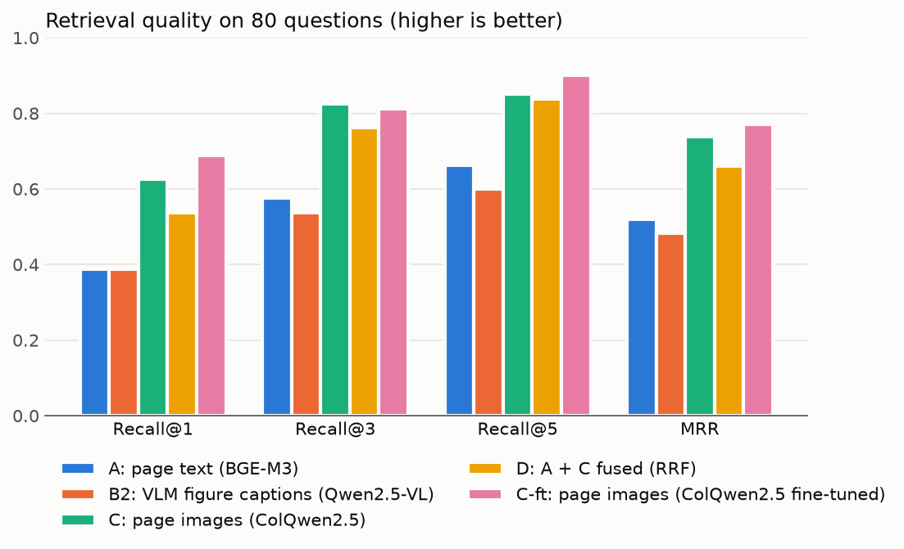
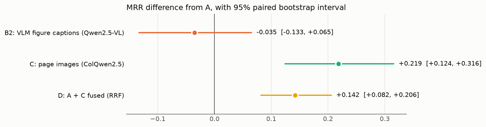
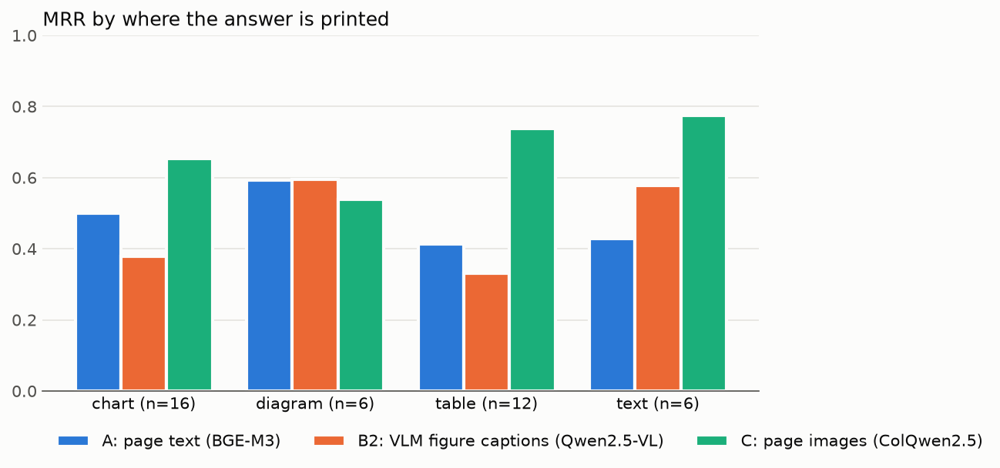

# multimodal-rag

Multimodal RAG over financial-report charts and tables. The goal is to compare three retrieval approaches on a hand-built evaluation set:

- **A. Text only**: PyMuPDF text extraction + text embeddings (baseline)
- **B. Figure captioning**: a vision LLM reads each whole page image and returns one structured description per chart or table (type, title, unit, Markdown table, summary), which is then embedded. B2 uses a local Qwen2.5-VL. B1 (the same with the Claude API) was planned but dropped by the developer's decision, so only B2 was run.
- **C. Page-image retrieval**: ColQwen2.5 multi-vector embeddings with late interaction (MaxSim)

> Status: retrieval for A, B2 and C is evaluated (below). Answer generation and grading are next. Data: 15 companies across 5 industries, 30 decks, 1,429 pages. Sources are listed in [docs/sources.csv](docs/sources.csv). The PDFs themselves are not redistributed.

## Retrieval results

40 questions ([eval/questions.csv](eval/questions.csv); format and scoring rules in [eval/README.md](eval/README.md)). Every method ranks all 1,429 pages for every question. A question counts as answerable at k when the top k pages cover every group of its gold pages. MRR uses the rank at which that first happens.

<picture>
  <source media="(prefers-color-scheme: dark)" srcset="results/figures/overall_dark.png">
  
</picture>

| Method | Recall@1 | Recall@3 | Recall@5 | MRR |
|---|---|---|---|---|
| A: page text (BGE-M3) | 0.350 | 0.525 | 0.600 | 0.477 |
| B2: VLM figure captions (Qwen2.5-VL 7B, BGE-M3) | 0.325 | 0.475 | 0.525 | 0.427 |
| C: page images (ColQwen2.5) | **0.575** | **0.725** | **0.775** | **0.680** |

Differences from A are paired over questions, with a 95% percentile bootstrap interval (10,000 resamples, seed 0):

<picture>
  <source media="(prefers-color-scheme: dark)" srcset="results/figures/mrr_diff_vs_a_dark.png">
  
</picture>

- **C beats the text baseline.** MRR +0.202 [+0.084, +0.329], Recall@5 +0.175 [+0.025, +0.325]. Both intervals exclude zero.
- **B2 is not distinguishable from A.** MRR −0.050 [−0.173, +0.076]. With 40 questions, this setup can't resolve differences of about ±0.1.
- **Much of B2's gap comes from captioning failures, not from retrieval.** For 4 questions (q009, q014, q035, q040), at least one required group of gold pages contains only pages where captioning failed (see Limitations), so B2 can never make them answerable. On those 4 questions A scores 0.035 of MRR, which is most of the 0.050 gap; q014 alone is at rank 1 for A.

Per-evidence and per-author tables, and the exact runs used (timestamp and commit), are in [results/comparison.md](results/comparison.md). That file and the charts are generated by `scripts/compare_methods.py`. The per-group results (6–16 questions per evidence type) are observations, not conclusions:

<picture>
  <source media="(prefers-color-scheme: dark)" srcset="results/figures/mrr_by_evidence_dark.png">
  
</picture>

### Indexing cost

Each method's indexing cost differs a lot. B2 needs one generation call per page before anything can be embedded. Captioning all 1,429 pages with `qwen2.5vl:7b` on the RX 9070 XT took **5.2 hours, about 13 s per page**. Generation is the bottleneck: a median of about 400 output tokens per page, each needing a full forward pass. Embedding the resulting 2,130 figure descriptions with BGE-M3 took about 9 seconds. Captions are cached per page, so adding a new deck only costs captioning for that deck's pages. A and C embed each page directly in a single forward pass.

## Limitations

- **Caption loops (B2).** 125 of 1,429 pages (8.7%) got no usable caption. Ollama aborted 23 of them with "token repeat limit reached". The other 102 hit the 4,096-token output cap, so their JSON was cut off. Of those, 100 ended in a repeated string, so they were loops too, not genuinely long tables. Failed pages are kept as "no figures" and not retried, since with temperature 0 and a fixed seed a retry fails the same way. These failures hit 7 of the 77 gold pages and make 4 questions unanswerable for B2. Adding a repetition penalty and recaptioning would probably help. It was not done, so the result above is for the settings as they were frozen.
- **Hallucinated figures on low-text pages (B2).** On section-divider pages that show only a heading, the model sometimes invents charts. The prompt was revised once, from v1 to v2, before the full run. That revision was checked only on pages that are not gold pages for any question. v2 still does this on some divider pages, and it was frozen anyway rather than tuned further.
- **Pages without figures are invisible to B2.** By design, B2 indexes only figure descriptions. A page the model judges to have no figures can't be retrieved. In this run every gold page without figures was a captioning failure, so this didn't cost a question by itself, but it would for text-only evidence.
- **C uses an English-trained retriever.** `vidore/colqwen2.5-v0.2` is trained mainly on English documents, and the queries here are Japanese. It still did best, but it was not tuned for this setting.
- **Small evaluation set.** 40 questions, of which 32 were written by Claude and 8 by the developer. Per-group counts are small. Claude wrote most questions, so no Claude model generates or grades answers in this project.

## Reproducing

```powershell
uv run python scripts/run_eval.py --config configs/method_a.toml
uv run python scripts/make_captions.py --config configs/method_b2.toml   # B2 only; resumable, about 5 h
uv run python scripts/run_eval.py --config configs/method_b2.toml
uv run python scripts/run_eval.py --config configs/method_c.toml
uv run python scripts/compare_methods.py
```

Each run is saved to `results/method_<x>/<timestamp>/`. `run.json` holds the config, the model revisions, the SHA-256 of the evaluation set and page list, the git commit (and whether the tree was clean), and package versions. `per_question.csv` holds each question's rank and top 10 pages. All settings were fixed in `configs/` before the first run of each method.

## Design decisions

**Caption whole pages instead of cropping figures (method B).** I first tried locating figures from the PDF structure: clustered vector drawings, embedded images and detected tables, merged into regions. On a sample of six slides from four industries, the crops regularly left out what a captioner needs most: units, legends, axis labels and the slide title. Some figures that fill the whole slide were split into fragments, and some tables lost their middle rows. IR slides are designed so that one page carries one message, so cropping removes context instead of focusing it. Method B therefore sends the full page image and asks for one structured description per figure. That keeps figure-level retrieval units without the cropping step.

## Environment

| | |
|---|---|
| OS | Windows 11 |
| GPU | AMD Radeon RX 9070 XT (gfx1201, 16 GB) |
| Python | 3.12 (system install via winget) |
| PyTorch | 2.14.0 + ROCm 10.1.0 (AMD's Windows wheels) |
| Local VLM | Ollama + `qwen2.5vl:7b` |

## Setup

```powershell
winget install --id Python.Python.3.12 -e
winget install --id astral-sh.uv -e
uv sync
uv run python scripts/check_gpu.py   # expects "GPU available : True" and "OK"
```

```powershell
winget install --id Ollama.Ollama -e
ollama pull qwen2.5vl:7b
```

## Setup notes

Problems hit while setting up ROCm PyTorch on Windows, and how they were solved:

1. **ROCm build of torch from AMD's index.** `pyproject.toml` lists AMD's index before PyPI, so `torch` and its `rocm-sdk-*` / `amd-torch-device-*` dependencies always come from AMD. This stops libraries added later from pulling in the CUDA build.
2. **`triton` breaks `uv lock`.** AMD's Windows wheel doesn't depend on `triton`, but the resolver reads the Linux wheel's metadata, which pins a Linux-only `triton`. `exclude-dependencies = ["triton"]` drops it.
3. **`uv.toml` overrides `[tool.uv]`.** When both exist, uv ignores the settings in `pyproject.toml`, so all uv settings live in `pyproject.toml`.
4. **AppData redirection.** Processes launched from a packaged (MSIX) app have their AppData writes redirected to a private location. A uv-managed Python installed that way can't be seen from a normal terminal. The fix is to use the winget Python (`python-preference = "only-system"`) and, for sessions started from such an app, to set `UV_CACHE_DIR` to a folder outside AppData. That path is machine-specific, so it lives in the untracked `.claude/settings.local.json`, not in `pyproject.toml`.
